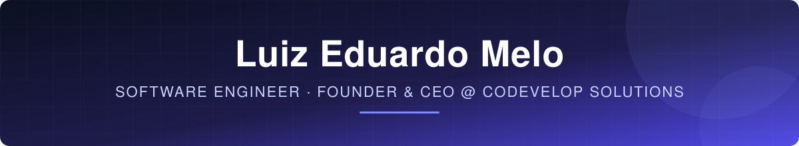
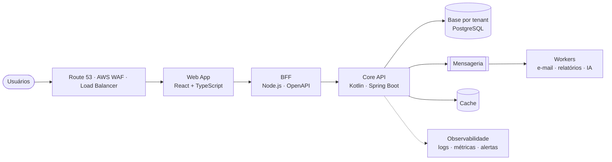

 

 

> **Eu transformo regras de negócio complexas em plataformas seguras, escaláveis e mensuráveis.**
> Engenheiro de software há mais de 6 anos em sistemas de missão crítica para o setor financeiro e o setor público,
> hoje lidero a **Codevelop Solutions** — software house e consultoria em cibersegurança — e construo produtos próprios
> de SaaS e Inteligência Artificial, da arquitetura ao go-live.

 

## ◆ O que eu construo

<table>
<tr>
<td width="33%" valign="top">

### 🏛️ SaaS B2B Multi-tenant
Plataformas com **isolamento de dados por cliente**, controle de acesso hierárquico, auditoria completa e
planos por capacidade — desenhadas para operar dados trabalhistas e financeiros sensíveis com **segurança de nível bancário**.

</td>
<td width="33%" valign="top">

### 🏦 Missão Crítica
Sistemas que não podem parar: **BACEN, Bradesco Seguros, PicPay, Banco do Nordeste, MPPE** e órgãos federais.
Alta disponibilidade, processamento em larga escala, integrações e conformidade regulatória.

</td>
<td width="33%" valign="top">

### 🤖 Produtos com IA
IA aplicada ao negócio — não demonstração. Assistentes especializados com base legal, trilhas de aprendizagem
adaptativas e automações que reduzem trabalho operacional de verdade.

</td>
</tr>
</table>

## ◆ Princípios de engenharia

| Pilar | Como eu aplico |
|---|---|
| 🔐 **Security by design** | Isolamento por tenant, WAF, MFA, menor privilégio, criptografia em trânsito e em repouso, trilha de auditoria e conformidade com a **LGPD** |
| 🧪 **Qualidade não negociável** | Pipeline com **≥ 90% de cobertura**, testes unitários e de integração em toda entrega, code review obrigatório e branches protegidas |
| 📐 **Arquitetura que envelhece bem** | Clean Architecture, DDD e SOLID — domínio independente de framework, infraestrutura substituível |
| 📜 **Contratos primeiro** | APIs e BFF documentados em **OpenAPI/Swagger**, rotas rastreáveis e testáveis de ponta a ponta |
| 📈 **Operação observável** | Logs estruturados, métricas, alertas e filas confiáveis — o sistema conta o que está acontecendo antes do cliente reclamar |
| ⚙️ **Tudo automatizado** | CI/CD, infraestrutura como código e deploys reproduzíveis na **AWS** |

## ◆ Arquitetura de referência

Padrão que uso em plataformas SaaS que lidam com dados sensíveis:

## ◆ Empreendimentos

| | Produto | O que é |
|---|---|---|
| 💼 | **[Codevelop Solutions](https://www.cdsolutions.com.br)** | Software house e consultoria em cibersegurança — desenvolvimento sob medida, integração de sistemas, segurança de redes e cloud |
| 🎙️ | **[SpeakFlow](https://www.speakflow.ia.br)** | Plataforma de IA para profissionais brasileiros que usam inglês no trabalho — web e mobile, software registrado no INPI |
| 🎒 | **[SpeakFlow Escolas](https://www.speakflowescola.com.br)** | Reforço escolar com IA para o ensino fundamental, com acompanhamento dos responsáveis e arquitetura por rede de ensino |
| 📊 | **SaaS de gestão trabalhista** *(em construção)* | Plataforma multi-tenant para escritórios contábeis: carteiras de clientes, rotinas de DP, BI gerencial, portal do cliente e IA especialista em direito do trabalho |

## ◆ Trajetória

| Cliente | Domínio | Stack |
|---|---|---|
| **BACEN** — Banco Central do Brasil | Ingestão e processamento de dados em larga escala | Java · Spring Boot · DB2 · OpenShift · Cucumber |
| **PicPay** — Chargeback | Sistemas financeiros críticos e observabilidade | Kotlin · Angular · AWS Lambda · API Gateway · S3 · Grafana |
| **Bradesco Seguros** | Transações de sinistros e integrações corporativas | Java EE · Spring Boot · Oracle · WebSphere · REST/SOAP |
| **Banco do Nordeste · FNDE** | Sistemas financeiros e de políticas públicas | Java · Spring Boot · Angular |
| **MPPE** — Ministério Público de PE | Sistemas de missão crítica e APIs seguras | Java · Spring Boot · Angular · PostgreSQL · GitLab CI/CD |
| **SICAR** — Governo da Bahia | Controle ambiental e dados georreferenciados | Java · Spring Boot · PostgreSQL · Docker |

EBIX → CAST Group → Netra (ACP Group) → NTT DATA → G4F Soluções Corporativas

## ◆ Stack

**Back-end** 

**Front-end & Mobile** 

**Dados, Cloud & DevOps** 

## ◆ Atividade

## ◆ Formação

- 🎓 Pós-graduação em **Engenharia de Software**
- 🤖 Pós-graduação em **Inteligência Artificial**
- ☁️ **Java & AWS Developer** — Digital Innovation One

 

*Arquitetura limpa, código que se sustenta e sistemas que não caem.*

